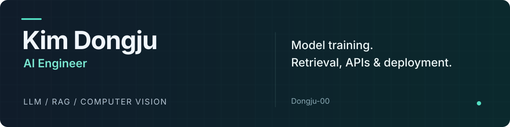
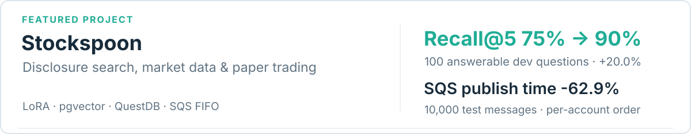
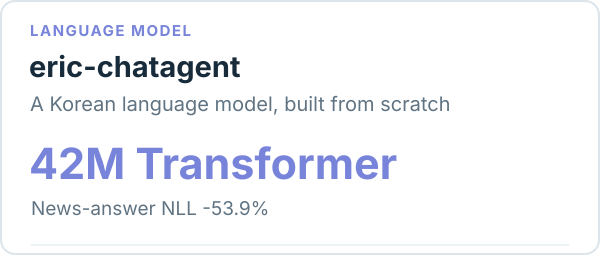
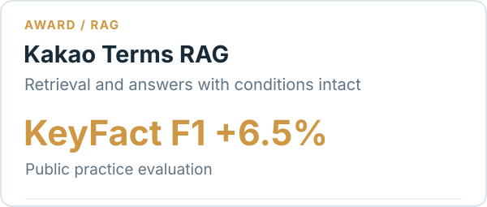
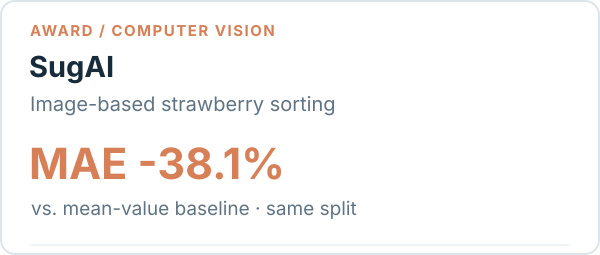
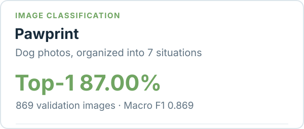

  

  <a href="https://app.notion.com/p/403890713f1481f886abd44b276d756a"><b>Portfolio</b></a>
  &nbsp; · &nbsp;
  <a href="https://app.notion.com/p/403890713f148150876ecc1ccf902ac3"><b>Dev Notes</b></a>
  &nbsp; · &nbsp;
  <a href="https://huggingface.co/Dongju-00"><b>Hugging Face</b></a>
  &nbsp; · &nbsp;
  <a href="mailto:djdj1473@gmail.com"><b>Email</b></a>

 

 

## Selected Projects

<a href="https://github.com/100-hours-a-week/KTB4-11th-AI">
  <picture>
    <source media="(prefers-color-scheme: dark)" srcset="./assets/stockspoon-dark.svg" />
    
  </picture>
</a>

<table>
<tr>
<td width="50%" valign="top">
<a href="https://github.com/Dongju-00/eric-chatagent"><picture><source media="(prefers-color-scheme: dark)" srcset="./assets/chatagent-dark.svg" /></picture></a>

개인 프로젝트 · 토크나이저와 모델 구현, 뉴스 검색, 학습·평가, FastAPI 서빙

</td>
<td width="50%" valign="top">
<a href="https://github.com/Dongju-00/kakao-terms-rag"><picture><source media="(prefers-color-scheme: dark)" srcset="./assets/terms-dark.svg" /></picture></a>

2인 팀 · 문항별 오류 분석, 모델·프롬프트 비교, T4 실험·제출 검증

</td>
</tr>
<tr>
<td width="50%" valign="top">
<a href="https://github.com/Dongju-00/Brix"><picture><source media="(prefers-color-scheme: dark)" srcset="./assets/sugai-dark.svg" /></picture></a>

5인 팀 · 직접 촬영·당도 측정, 전처리·학습, Arduino·Jetson 연동

</td>
<td width="50%" valign="top">
<a href="https://github.com/Dongju-00/KTB-hackerton-team5-ai"><picture><source media="(prefers-color-scheme: dark)" srcset="./assets/pawprint-dark.svg" /></picture></a>

6인 팀 · 이미지 수집·정제, 데이터 균형화, 분류 모델 학습·평가

</td>
</tr>
</table>

### 코드와 실험 기록

<b>스톡스푼</b> — 공시 검색 평가와 계좌별 병렬 발행

실시간 시장 데이터와 AI 분석을 연결한 모의투자 서비스입니다. 팀 6명 중 AI 2명으로 참여해 시장 데이터 수집, 분석 검증, 공시 학습·검색 평가와 SQS 주문 요청 발행을 맡았습니다.

- 공시 임베딩 LoRA 학습과 GPU 서빙. Qwen3-Reranker-4B 재정렬 적용 후 **Recall@5 75% → 90% (20.0% 상승, +15%p)** 확인.
- 같은 계좌는 순차, 다른 계좌는 병렬 발행. 테스트 환경의 1만 건 발행 **112.986 → 41.938초 (62.9% 단축)**.

`Python` `PyTorch` `PEFT/LoRA` `LangChain` `PostgreSQL/pgvector` `QuestDB` `SQS FIFO`

[Repository](https://github.com/100-hours-a-week/KTB4-11th-AI) · [공시 GPU·RAG 평가 기록](https://app.notion.com/p/403890713f1481dcbcddf40d760c4469) · [SQS 병렬도 실험](https://app.notion.com/p/403890713f1481f5bdd0df9c711ee6a8)

<b>eric-chatagent</b> — 직접 만든 한국어 모델의 학습과 실제 답변 비교

일상 대화와 주식 뉴스 질의응답을 연결한 개인 프로젝트입니다.

- 약 **42M 파라미터의 Decoder-only Transformer** 직접 구현. 뉴스·대화 데이터를 구성하고 답변 토큰만 학습하는 SFT부터 FastAPI 서빙까지 연결
- 뉴스 답변 NLL **3.292 → 1.519 (53.9% 감소)**.

`PyTorch` `SentencePiece` `LangGraph` `ChromaDB` `FastAPI` `Docker`

[Repository](https://github.com/Dongju-00/eric-chatagent) · [구현·서빙 회고](https://app.notion.com/p/403890713f148150876ecc1ccf902ac3) · [멀티턴 데이터·학습 기록](https://app.notion.com/p/403890713f1481d3a10ae222e32cc810)

<b>카카오 약관 RAG</b>

약관의 조항을 찾아 조건과 예외까지 답하는 RAG 파이프라인입니다. 2인 팀에서 테스트·성능개선, 문항별 오류 분석, 후보 비교와 제출 검증을 맡았습니다.

- 공개 문항의 검색 MRR이 1.0이어도 답변에서 주체·기간·예외 누락. 모델·프롬프트·답변 선택 방식 비교 후 평가 **KeyFact F1 0.7076 → 0.7537 (6.5% 상승)** 확인
- T4 16GB에서 Qwen2.5-7B를 NF4 4bit로 로드하고, 조항 인코딩 후 BGE-M3를 CPU로 이동
- 초기화 세션의 HTTP **36요청 모두 성공**. 회차별 p95 중앙값 **82.345초**로 요청당 120초 제한 충족

`BM25` `BGE-M3` `RRF` `Qwen2.5` `NF4` `Colab T4`

[Repository](https://github.com/Dongju-00/kakao-terms-rag) · [실험·기술 선택 기록](https://app.notion.com/p/402890713f148106878ce7adb1de19de)

<b>SugAI</b> — 사진의 RGB·HSV 차이를 찾아 당도 예측 수정

객체 검출·촬영, 당도 예측과 장치 제어를 연결한 딸기 자동 선별 시스템입니다. 데이터 수집·전처리·모델 학습과 Arduino·Jetson 연동을 맡았습니다.

- 학습 사진과 실제 검출 영역 사진의 차이를 확인하고 전처리를 맞춰 재학습. 촬영 조건을 나눈 k-fold 검증에서 **MAE 1.154** 기록
- 동일 분할의 평균값 예측 기준 **1.864 대비 오차 38.1% 감소**

`PyTorch` `YOLOv5` `SORT` `OpenCV` `FastAPI` `Arduino` `Jetson`

[Repository](https://github.com/Dongju-00/SugAI) · [개발 회고](https://app.notion.com/p/403890713f148153a78be35f9e1d901d) · [실험 기록](https://app.notion.com/p/403890713f14811499a2ee69f8f34afa)

<b>Pawprint</b> — 자동 라벨링과 분류

반려견 사진을 행동·상황에 따라 7개 카테고리로 정리하는 분류 모델입니다. 이미지 수집·정제와 모델 학습·평가를 맡았습니다.

- CLIP으로 상황 라벨 후보 생성 후 pHash 중복 제거·YOLO 개 검출 확인. 데이터 균형화와 모델 변경 후 검증 869장에서 **Top-1 87.00%, Macro F1 0.869** 기록

`PyTorch` `CLIP` `YOLOv8n` `EfficientNet` `pHash`

[Repository](https://github.com/Dongju-00/KTB-hackerton-team5-ai) · [데이터·학습·실험 기록](https://app.notion.com/p/402890713f14817884a9eb9017ce5301)

 

## Tech Stack

| 분야 | 주로 사용하는 기술 |
| :--- | :--- |
| **Model & Data** | Python · PyTorch · Transformers · PEFT/LoRA · SentencePiece · NumPy · pandas |
| **Retrieval & Agent** | LangChain · LangGraph · BM25 · BGE-M3 · pgvector · ChromaDB · RAGAS |
| **Service & Infra** | FastAPI · PostgreSQL · QuestDB · SQS · Docker · AWS EC2 · CloudWatch · GitHub Actions |

 

## Awards

| 연도 | 수상 | 프로젝트 |
| :--- | :--- | :--- |
| 2026 | 카카오테크 부트캠프 AI 부하테스트·성능개선 대회 **우수상** | 카카오 약관 RAG |
| 2025 | 한이음 드림업 공모전 창의도전형 **동상** | SugAI |

 

Contact · <a href="mailto:djdj1473@gmail.com">djdj1473@gmail.com</a>

